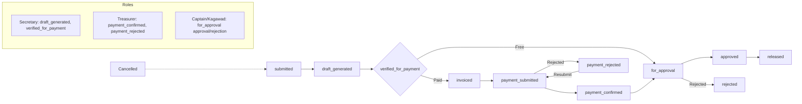

# Barangay E-Document System — Workflow Flowcharts

Simple Mermaid diagrams for the key workflows.

---

## 1. User Registration Process

```mermaid
flowchart TD
    A[Start: User Opens App] --> B{Has Govt ID?}
    B -->|Yes| C[4-Step Registration:\n1. Account\n2. Personal\n3. Address\n4. Documents]
    B -->|No - Indigent| D[Tick "No valid Govt ID"\nEnter Reason]
    C --> E[Upload Profile Photo + ID]
    E --> F[AI Pre-Check (advisory only)]
    F --> G[Account Created: pending\n+ KYC AI Result Stored]
    D --> H[Account Created: pending\n+ is_indigent=true]
    G --> I[Route to /pending-approval]
    H --> I
    I --> J[Review by Captain/Admin]
    J -->|Approve| K[Approved: signed-in immediately]
    J -->|Reject| L[Rejected: show reason]
    
    subgraph Face-Matched Signup (Mobile Only)
        M[Face Pre-Enrolled by Official] --> N[Selfie + Name Match via Edge Function]
        N -->|Match ≥ 0.5| K
        N -->|No Match| O[Blocked: Visit Barangay Office]
    end
    
    K --> P[Dashboard by Role]
```

---

## 2. Login Validation and Role Identification

```mermaid
flowchart TD
    A[POST /login: email + password] --> B[Verify SHA-256 hash\nin users_profile]
    B -->|Invalid| C[Show Error: Invalid credentials]
    B -->|Valid| D[Load UserProfile]
    D -->|is_approved = false| E[Route to /pending-approval]
    D -->|is_approved = true| F{Check Role}
    
    F -->|citizen| G[/citizen/dashboard]
    F -->|captain / admin| H[/admin/dashboard]
    F -->|secretary| H
    F -->|treasurer| H
    F -->|kagawad_representative| H
    F -->|barangay_tanod| I[/tanod/dashboard]
    
    A --> J[Set session in shared_preferences]
    J --> F
```

---

## 3. Barangay Captain Interface Workflow

```mermaid
flowchart TD
    A[/admin/dashboard] --> B[Pending Users Card\nbadge: count]
    A --> C[Captain Approval Queue\nbadge: count]
    A --> D[Pending Payments Queue]
    A --> E[All Requests View]
    A --> F[Settings]
    A --> G[User Management]
    
    B --> H[Manage Users Screen]
    H --> I[View Pending Registration]
    I --> J[Approve/Reject + AI Summary]
    J --> K[Notification to Citizen]
    
    C --> L[Document Request Detail]
    L --> M[Approve/Reject]
    M --> N[Generate PDF + Release]
    N --> O[Verification token created\nDocument marked 'released']
    O --> P[Notification to Citizen]
    
    D --> Q[View Pending Payments]
    Q --> R[Confirm/Reject Payment Receipt]
    R --> S[Update status → for_approval]
    
    F --> T[Edit Barangay Details]
    F --> U[Edit Document Fees]
    F --> V[View Document Formats]
    
    subgraph Permissions
        W[canManageUsers = true]
        X[canApproveDocuments = true]
        Y[canManageFees = true]
    end
```

---

## 4. Barangay Secretary Interface Workflow

```mermaid
flowchart TD
    A[/admin/dashboard] --> B[Pending Reviews Queue\nbadge]
    
    B --> C[Document Request Detail]
    C --> D{Status?}
    D -->|submitted| E[Generate Draft PDF]
    D -->|draft_generated| F[Review + Release OR\nRequest Revision]
    D -->|verified_for_payment| G[Mark Verified for Payment\n→ invoiced]
    
    E --> H[Status: draft_generated]
    F --> I[Release Document OR\nReject with Reason]
    G --> J[Send Invoice to Citizen]
    
    subgraph Fee Assessment
        K[Fee = $0?]
        K -->|Yes| L[Route to for_approval\n(Skip Treasurer)]
        K -->|No| M[Route to invoiced\n(Citizen pays Treasurer)]
    end
    
    subgraph Permissions
        N[canGenerateDrafts = true]
        O[canReviewDocuments = true]
        P[canReleaseDocuments = true]
    end
```

---

## 5. Barangay Treasurer Interface Workflow

```mermaid
flowchart TD
    A[/admin/dashboard] --> B[Pending Payments Queue\nbadge]
    
    B --> C[Invoice Card:\n- Amount\n- Due Date\n- GCash Details]
    C --> D[Citizen Uploads Receipt]
    D --> E[Payment Status: payment_submitted]
    
    E --> F[Treasurer Action]
    F --> G[Confirm Payment]
    F --> H[Reject Payment]
    
    G --> I[Require Official Receipt Photo]
    I --> J[Status: payment_confirmed]
    J --> K[Notification to Citizen\n+ Route to Captain]
    
    H --> L[Status: payment_rejected]
    L --> M[Notification to Citizen\nto Resubmit]
    
    subgraph Actions
        N[canVerifyPayments = true]
        O[View Official Receipt URL]
        P[Update Payment Status]
    end
```

---

## 6. Barangay Tanod Workflow

```mermaid
flowchart TD
    A[/tanod/dashboard] --> B[Duty Card:\nOpen Incidents\nUrgent Count]
    
    B --> C[Priority Filter Chips:\nurgent, high, normal, low]
    C --> D[Incident Cards Feed\n(sorted urgent-first)]
    
    D --> E[Incident Card]
    E --> F[Tap → Incident Detail]
    F --> G[View Details:\nType, Location, Description]
    F --> H[Map Pin (if provided)]
    G --> I[Update Status:\nOpen → Resolved/Closed/Dismissed]
    I --> J[Notification to Captain]
    
    subgraph Tanod-Specifics
        K[Incident Report Type:\nPolice, Fire, Medical, etc.]
        L[Priority Auto-Suggested by AI\nor Manual Selection]
        M[Can view reporter identity\n(canRevealSensitiveReporter)]
    end
    
    subgraph Actions Available
        N[isOfficer = true]
        O[canManageReports = true]
    end
```

---

## 7. Resident Workflow

```mermaid
flowchart TD
    A[/citizen/dashboard] --> B{Residency Verified?}
    B -->|null/false| C[/verify-residency]
    B -->|true| D[Document Request Flow]
    
    C --> E[AI Residency Verifier]
    E --> F[Show to Captain for Manual Confirmation]
    F --> G[Set is_poblacion_resident = true]
    
    D --> H[Submit Document Request]
    H --> I{Type?:\nClearance, ID, Cedula,\netc.}
    
    I --> J[Fill Required Fields]
    J --> K[AI Check Details (optional)]
    K --> L[Submit Request]
    
    L --> M[Status: submitted]
    M --> N[Secretary → draft_generated]
    N --> O{Fee?}
    O -->|Free| P[Captain Approval]
    O -->|Paid| Q[Treasurer → payment_confirmed]
    P --> R[Captain Approval]
    Q --> R
    
    R --> S[Status: released]
    S --> T[Download PDF\nView Verification Page]
    
    subgraph Notifications
        U[Live updates via Realtime]
        V[Queue badge on dashboard]
    end
```

---

## 8. Chatbot Interface

```mermaid
flowchart TD
    A[Citizen Dashboard\nor Citizen App Bar] --> B[Open Chatbot Screen]
    
    B --> C[Welcoming Message\n+ Localized Suggestions]
    C --> D[User Asks Question]
    
    D --> E{Network?\nAI Available?}
    E -->|Yes| F[Call AI Edge Function\n(chatbot task)]
    E -->|No| G[Use Offline FAQ\nKeyword Match]
    
    F --> H{AI Responded?}
    H -->|Yes| I[Show AI Reply\n+ Suggested Follow-ups]
    H -->|Error/Timeout| G
    
    G --> J[Show FAQ Answer\n+ "Try the assistant" notice]
    
    I --> K[Continue Conversation\nor New Question]
    J --> K
    
    subgraph AI Features
        L[gemini-2.5-flash\nvia Supabase Edge Function]
        M[Graceful degradation\nto offline keywords]
        N[Localized content\n(English, Filipino, Cebuano)]
    end
```

---

## Key Status Flow (Document Pipeline)



---

## Role Permissions Matrix

```mermaid
graph TD
    Captain[Captain] --> |canManageUsers| ManageUsers[User Management]
    Captain --> |canApproveDocuments| ApproveDocs[Document Approval]
    Captain --> |canManageFees| ManageFees[Fee Management]
    Captain --> |canPostAnnouncements| PostAnnouncement[Post Announcements]
    Captain --> |canManageReports| ManageReports[Incident Reports]
    Captain --> |canRevealSensitiveReporter| ViewReporter[View Reporter Identity]
    
    Secretary[Secretary] --> |canGenerateDrafts| GenDraft[Generate Drafts]
    Secretary --> |canReviewDocuments| ReviewDocs[Review Documents]
    Secretary --> |canReleaseDocuments| ReleaseDocs[Release Documents]
    Secretary --> |canPostAnnouncements| PostAnnouncement
    
    Treasurer[Treasurer] --> |canVerifyPayments| VerifyPay[Verify Payments]
    Treasurer --> |canManageFees| ManageFees
    
    Tanod[Tanod] --> |canManageReports| ManageReports
    
    Citizen[Citizen] --> CitizenActions[Submit Documents\nReport Incidents]
    
    Admin[Admin] --> All[All Permissions]
```



---

## Notes

- **Authentication**: SHA-256 hash (salt:timestamp-derived) stored in `users_profile.password_hash`
- **Sessions**: Stored in `shared_preferences`, restored by `splash_screen.dart`
- **Notifications**: Client-side fan-out via `NotificationService`
- **Real-time**: `supabase_realtime` publication for live updates
- **AI Fallback**: Chatbot degrades to offline FAQ when AI unavailable