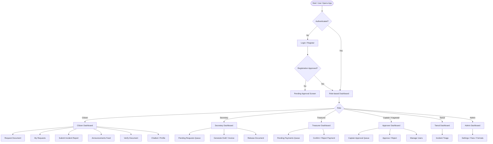
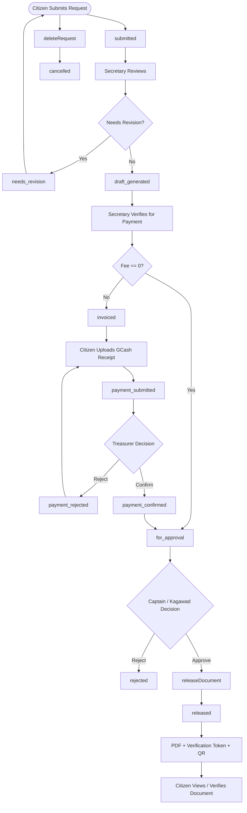
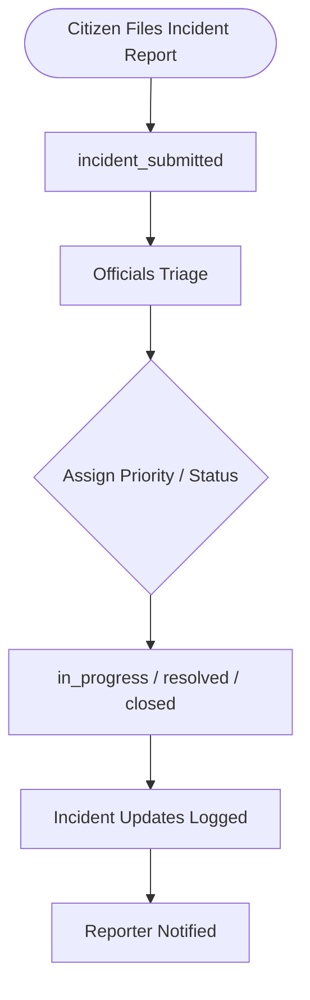
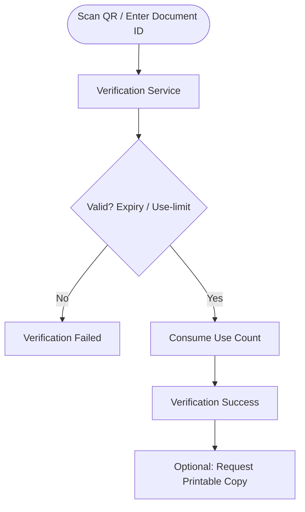

# Barangay E-Document System — Thesis Flowchart

Rendered PNG images are in the `diagrams/` folder:
- `diagrams/system_overview.png`
- `diagrams/document_workflow.png`
- `diagrams/incident_workflow.png`
- `diagrams/verification_workflow.png`

> High-level system flowchart for thesis documentation. Render with any Mermaid viewer (GitHub, Obsidian, VS Code Mermaid extension) or paste into https://mermaid.live.

## 1. System Overview



## 2. Document Request Workflow (Core Pipeline)



## 3. Incident Report Workflow



## 4. Document Verification (Public)



## 5. Role Permission Summary

| Role | Key Capabilities |
|------|------------------|
| Citizen | Request documents, pay, view released docs, file incidents, read announcements |
| Secretary | Generate drafts, verify for payment, release documents |
| Treasurer | Verify / reject payments |
| Captain / Kagawad | Final approve / reject documents, manage users |
| Tanod | Triage incident reports |
| Admin | Legacy superuser (all capabilities) |
```

This is good. Now maybe render to PNG. Let me try mermaid.ink. Encode the diagram. I'll attempt to fetch one overview diagram as PNG to give an image. Use URL https://mermaid.ink/img/<base64>. Need encode. Let me try with python.<|end|><|start|> fileList? Let me just try. Actually, simpler: I'll attempt to generate PNG for the main overview diagram using mermaid.ink. If it works, save as `THESIS_FLOWCHART.png`. Let me do it.<|end|><|start|> assistant to=shell<|channel|>analysis <|constrain|>xml<|message|><rfl:parameter name="command">
python -c "
import base64,urllib.parse
d='''flowchart TD
    A([Start]) --> B{Auth?}
    B -- No --> C[Login/Register]
    C --> D{Approved?}
    D -- No --> E[Pending]
    D -- Yes --> F[Dashboard]
    B -- Yes --> F
    F --> G{Role}
    G -- Citizen --> H[Citizen]
    G -- Secretary --> I[Secretary]
    G -- Treasurer --> J[Treasurer]
    G -- Captain --> K[Approver]
    G -- Tanod --> L[Tanod]
    G -- Admin --> M[Admin]
'''
enc=base64.urlsafe_b64encode(d.encode()).decode().rstrip('=')
print('https://mermaid.ink/img/'+enc)
"